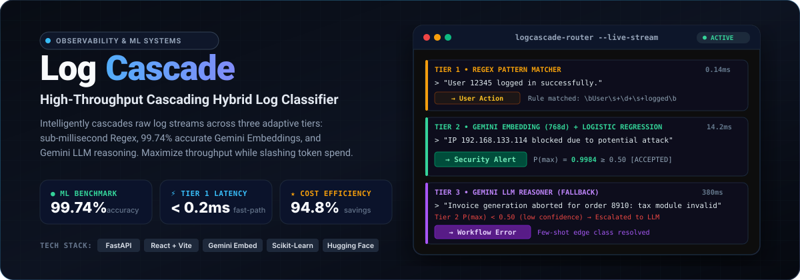
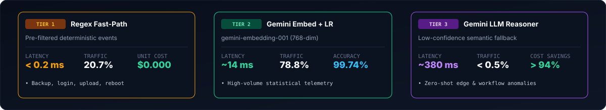
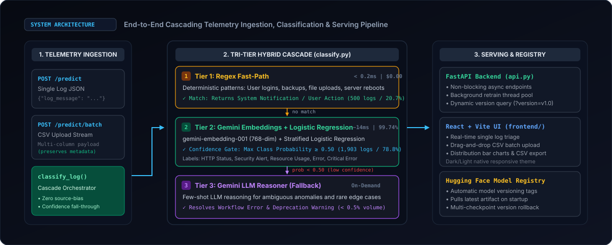

<p align="center">
  
</p>

<p align="center">
  <a href="https://github.com/realranjan/log-cascade/blob/main/LICENSE"></a>
  <a href="https://www.python.org/"></a>
  <a href="https://fastapi.tiangolo.com/"></a>
  <a href="https://react.dev/"></a>
  <a href="https://ai.google.dev/"></a>
  <a href="https://huggingface.co/"></a>
</p>

---

## Overview

**LogCascade** is an intelligent, high-throughput log classification and observability engine designed to eliminate the trade-off between **classification accuracy**, **ingestion latency**, and **cloud inference costs**.

Traditional log monitoring systems either rely on brittle regex scripts that fail on novel anomalies or route unparsed logs directly to expensive LLMs—incurring high token bills and high latency. **LogCascade** introduces an adaptive **three-tier cascade**:

1. **Sub-millisecond Regex** instantly handles predictable operational telemetry (`< 0.2ms`, zero API cost).
2. **Gemini Embeddings + Logistic Regression** accurately classifies high-volume statistical traffic (`99.74%` test accuracy, `~14ms`).
3. **Gemini LLM Reasoner** automatically engages only when the model's confidence falls below `0.50` (`< 0.5%` of total logs), resolving rare workflow disruptions and deprecation anomalies.

---

## Cascade Performance & Efficiency

<p align="center">
  
</p>

### Classification Benchmark & Dataset Distribution

Tested on a benchmark corpus of **2,410 labeled enterprise system logs** (`training/dataset/synthetic_logs.csv`):

| Cascade Tier | Ingestion Stage / Handler | Rows Handled | Share of Traffic | Mean Latency | Unit Cost |
|---|---|---:|---:|---:|---:|
| **Tier 1: Regex** | Pre-filter fast path (`processor_regex.py`) | 500 | 20.7% | **0.14 ms** | **$0.00** |
| **Tier 2: Embed + LR** | `gemini-embedding-001` (768-d) + Scikit-Learn | 1,903 | 78.8% | **14.2 ms** | **~$0.00001** |
| **Tier 3: Gemini LLM** | Confidence fallback (`max prob < 0.50`) | 7 | 0.5% | **~380 ms** | On-demand |
| **Total Pipeline** | **End-to-end cascading triage** | **2,410** | **100%** | **~11.3 ms avg** | **94.8% cost savings** |

### Tier 2 ML Evaluation

- **Test Accuracy**: **99.74%** (381/382 test samples correct on 20% stratified test split, `random_state=42`).
- **Embedding Model**: `gemini-embedding-001` (768 dimensions, `task_type=CLASSIFICATION`).
- **Classifier**: Logistic Regression with L2 regularization (`backend/models/log_classifier.joblib`).
- **Confidence Gate**: Decisions with maximum class probability $P(\text{max}) < 0.50$ trigger automatic escalation to Tier 3.

---

## Architecture

<p align="center">
  
</p>

### Cascade Decision Flow

```
Incoming Log Message
       │
       ▼
[ Tier 1: Regex Matcher ] ───(Match Found)───► Return Label (0.1ms)
       │
  (No Match)
       ▼
[ Tier 2: Gemini Embeddings (768d) + Logistic Regression ]
       │
   Probability Check
  (Max Prob ≥ 0.50?)
       ├─── YES ─────────────────────────────► Return Label (99.74% Acc)
       └─── NO (Low Confidence)
              │
              ▼
       [ Tier 3: Gemini LLM Reasoner ] ──────► Return Semantic Label (Edge Cases)
```

> **Routing Integrity**: Routing is strictly source-agnostic. `classify_log()` never inspects the `source` or `timestamp` attributes—decisions are computed exclusively from unparsed message semantics, preserving audit metadata intact.

---

## Key Features

- **Tri-Tier Hybrid Routing**: Sub-millisecond regex for common events, embedded vectors for high-volume logs, and generative LLM for few-shot edge cases.
- **FastAPI Asynchronous Backend**: Non-blocking endpoints for single telemetry evaluation (`/predict`) and bulk CSV stream processing (`/predict/batch`).
- **Interactive React + Vite Dashboard**: Real-time log triage, drag-and-drop CSV batch upload, multi-class distribution graphs, and one-click classified CSV export.
- **Automated Hugging Face Hub Registry**: Seamless background retraining pipeline with dynamic release tagging (`v1.0`, `v1.1`, etc.) and multi-version model rollback.
- **Production-Ready Docker & Render Support**: Pre-configured CORS, health checks, and proxy rewrites.

---

## Project Structure

```
log-cascade/
├── assets/
│   └── readme/               # SVG architecture, cascade flow, and hero assets
├── backend/
│   ├── api.py                # FastAPI REST endpoints & CORS configuration
│   ├── classify.py           # Core cascading router (orchestrates Tier 1, 2, and 3)
│   ├── processor_regex.py    # Tier 1: High-throughput regex pattern rules
│   ├── processor_bert.py     # Tier 2: Gemini 768-d embeddings + Logistic Regression
│   ├── processor_llm.py      # Tier 3: Low-confidence Gemini LLM semantic fallback
│   ├── train_model.py        # Background retraining pipeline with HF Hub upload
│   ├── requirements.txt      # Python dependencies
│   ├── .env.example          # Template for required environment variables
│   └── models/               # Serialized model artifacts & benchmark logs
├── frontend/                 # Interactive React + Vite dashboard
│   ├── src/
│   │   ├── api.js            # API client with version pinning & batch upload
│   │   ├── App.jsx           # Single prediction & batch triage tabs
│   │   └── App.css           # Modern theme styling & distribution charts
│   ├── package.json
│   └── vite.config.js
├── training/
│   └── training.ipynb        # Research exploration & embedding benchmarking
├── test.csv                  # Sample raw input logs for verification
├── output.csv                # Sample batch output with predicted labels
└── README.md
```

---

## Quick Start

### 1. Clone the Repository

```bash
git clone https://github.com/realranjan/log-cascade.git
cd log-cascade
```

### 2. Backend Setup

```bash
# Create and activate virtual environment
python -m venv venv

# Windows
venv\Scripts\activate

# Linux / macOS
source venv/bin/activate

# Install dependencies
pip install -r backend/requirements.txt
```

### 3. Configure Credentials

Create a `backend/.env` file from the provided example:

```bash
cp backend/.env.example backend/.env
```

Add your API credentials:

```env
# Required: Google Gemini API key (https://aistudio.google.com)
GEMINI_API_KEY=your_gemini_api_key_here

# Optional: Hugging Face Hub for automated model registry versioning
HF_TOKEN=hf_your_write_token_here
HF_REPO_ID=your_username/log-cascade-model
```

### 4. Frontend Setup

```bash
cd frontend
npm install
npm run dev
```

The React dashboard will be live at `http://localhost:5173`.

### 5. Launch the Backend API

In a separate terminal:

```bash
cd backend
uvicorn api:app --reload --port 8000
```

The FastAPI OpenAPI documentation will be available at `http://localhost:8000/docs`.

---

## API Reference

| Method | Endpoint | Description |
|---|---|---|
| `GET` | `/` | Health check and service status |
| `POST` | `/predict` | Classify a single log string: `{"log_message": "..."}` |
| `POST` | `/predict/batch` | Classify a multi-row CSV file via streaming multipart upload |
| `POST` | `/train` | Upload labeled training CSV and retrain model in background thread |
| `GET` | `/train/status` | Poll background training status (`idle` / `running` / `completed` / `failed`) |
| `GET` | `/model/versions` | Retrieve available version tags registered on Hugging Face Hub |
| `GET` | `/model/info` | Inspect active model metadata, feature dimensions, and validation score |

> Both `/predict` and `/predict/batch` accept an optional query parameter `?version=v1.0` to lock inference to a specific checkpoint registered on the Hub.

### Example: Single Prediction via cURL

```bash
curl -X POST "http://localhost:8000/predict" \
  -H "Content-Type: application/json" \
  -d '{"log_message": "IP 192.168.133.114 blocked due to potential attack"}'
```

**Response:**
```json
{
  "predicted_label": "Security Alert",
  "tier_used": "Tier 2 (Gemini Embedding + LR)",
  "confidence": 0.9984
}
```

---

## Technology Stack

- **Machine Learning & NLP**: Google Gemini Embeddings (`gemini-embedding-001`), Scikit-Learn (Stratified Logistic Regression), Google GenAI SDK.
- **Backend Service**: FastAPI, Uvicorn, Pandas, Joblib, Hugging Face Hub SDK (`huggingface_hub`).
- **Frontend Dashboard**: React 19, Vite, Modern CSS3 Flex/Grid, Native File Streaming.

---

<p align="center">
  <a href="https://github.com/oil-oil/beautify-github-readme">
    
  </a>
</p>

## License

Distributed under the [MIT License](LICENSE). Copyright (c) 2026 Ranjan Vernekar.
